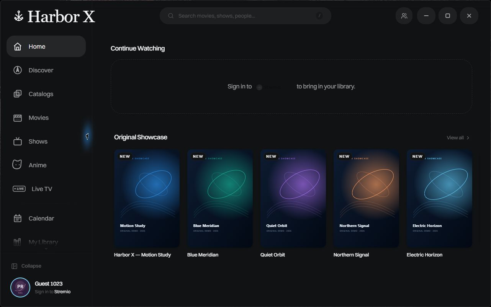
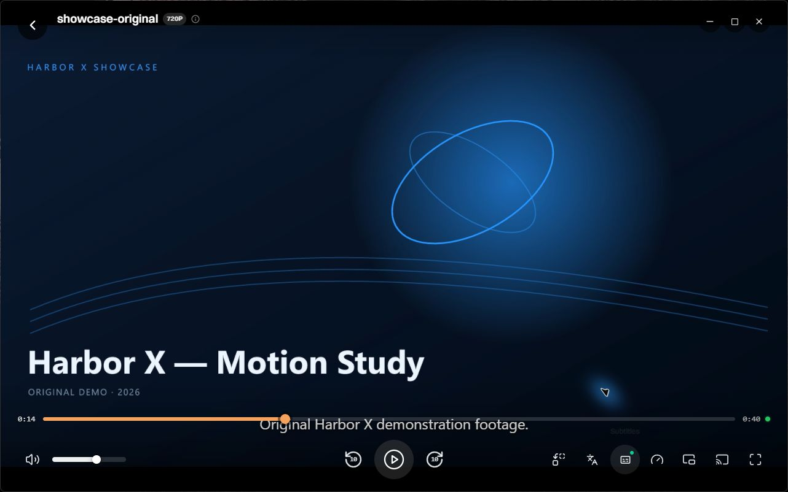
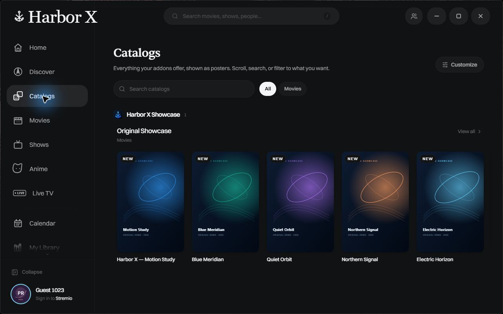
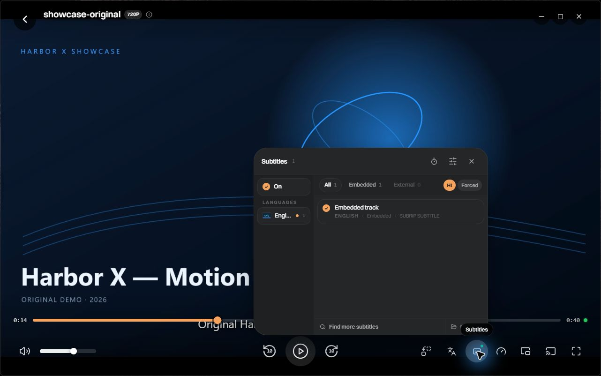
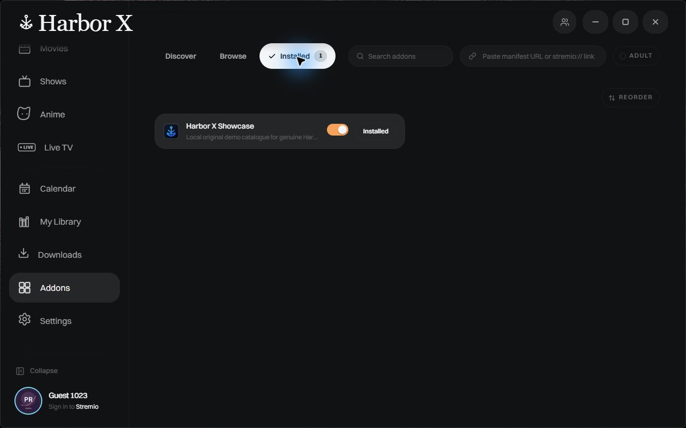
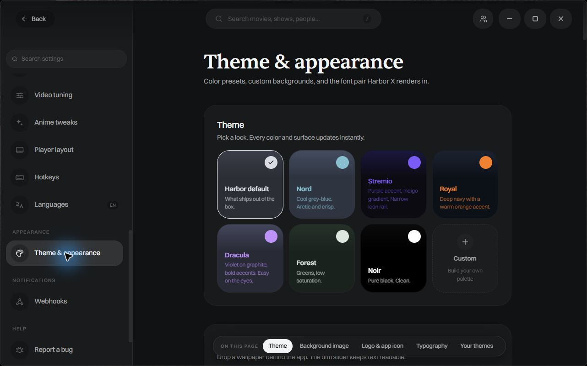

<h1 align="center">Harbor X</h1>

Browse your sources. Make the player yours. Enjoy your media in one Windows app.

<strong>Maintained by Splash · Based on Harbor</strong>

<a href="#download-harbor-x"><strong>Download for Windows</strong></a> · <a href="#key-features">Key features</a> · <a href="#screenshots">Screenshots</a> · <a href="#open-source--licenses">Source & licences</a>

## About Harbor X

Harbor X is a Windows desktop media application for browsing compatible catalogs, organizing your viewing and playing media with subtitles and configurable controls. It builds on the original **Harbor** project; the original authors retain their copyright and licence grants.

Harbor X does not host a film or television service and does not supply a subscription or a preconfigured content collection. Access depends on your local files and the sources or compatible addons you choose, with the permissions and licences applicable to that content.

*Example Home configuration using an original demonstration catalog.*

## Key Features

### A clear starting point

Home, browsing sections, search and media detail pages bring your configured catalogs into one interface. You can choose what appears on Home and arrange its rows around the sources you actually use; results depend on the providers you have configured.

### Playback inside the app

The integrated mpv-based player keeps the picture and playback controls together in Harbor X. Pause and resume, seek forward or backward, adjust volume and move between windowed and full-screen viewing without opening a separate media application.

### Subtitles you can adjust

Choose an available subtitle track, turn it on or off and correct its timing when it does not line up with the audio. Subtitle appearance settings and language preferences help make reading comfortable; subtitle availability depends on the file or provider, rather than a promise that every title has subtitles.

### Compatible Stremio addons

Manage addons that implement the Stremio addon protocol and add a compatible manifest URL from the Addons page. Catalog, stream and subtitle support depends on each addon: Harbor X does not guarantee every external addon or install third-party content sources for you.

### Keep track of what matters

Use the available library, watchlist and continue-watching tools to return to media and organize your viewing. Local organization does not require importing someone else's accounts or settings; optional service connections have their own account requirements.

### Make the interface yours

Choose a theme, adjust the appearance and personalize the player controls and Home layout. The layout editor can show, hide and arrange supported player buttons, so the viewing interface can reflect the controls you use most.

### Local files and your selected sources

Open supported local media or choose a stream returned by your configured sources. Actual format support, hardware decoding and advanced HDR behavior depend on the media and your system; this release does not claim comprehensive HDR10, Dolby Vision or multichannel-audio certification.

### Updates with a signature check

Harbor X is configured to check this release repository and verify Tauri update signatures with its embedded production public key before handing an update to the installer. Installation requires your approval; a successful local signature check is separate from a completed live production update cycle.

## Screenshots

These are genuine captures of the 0.9.26 interface from an isolated showcase build with the same reviewed frontend, a separate demo profile and original, locally hosted demonstration artwork/media. They contain no personal account or commercial film imagery. The showcase addon and demo data are **not included** in the installer.

| Browse | Subtitle controls |
|:---:|:---:|
|  |  |
| Addons | Appearance & customization |
|  |  |

## Download Harbor X

### [Download Harbor X 0.9.26 — Windows x64](https://github.com/mahdi88m2025-afk/Harbor-X-Releases/releases/download/v0.9.26/Harbor-X-Setup-0.9.26.exe)

[Latest release](https://github.com/mahdi88m2025-afk/Harbor-X-Releases/releases/latest) · [Open 0.9.26](https://github.com/mahdi88m2025-afk/Harbor-X-Releases/releases/tag/v0.9.26) · [All releases](https://github.com/mahdi88m2025-afk/Harbor-X-Releases/releases)

Most users need **only the Setup.exe**. The source archives, public update key and signature/checksum files are provided for source access, licence compliance and verification; they are not additional programs you need to install.

> **Windows signing:** This release has no Windows Authenticode certificate. Windows may show **Unknown Publisher** or a **Microsoft Defender SmartScreen** warning. Splash is the product's publisher label, not a certificate-verified Windows publisher. Do not disable Defender or SmartScreen. Check the download origin and the release checksums before deciding whether to proceed. Tauri update signatures serve a different purpose and do not remove Windows trust warnings.

## Installation

1. Download the Setup.exe from the release link above.
2. Open the interactive installer and select the installation scope and destination folder. Choose the desktop shortcut option if you want it.
3. Finish installation and open **Harbor X** from Start. New users start with their own fresh settings; no personal accounts, API keys or addon collection are shipped.
4. Configure your own authorized local media or compatible sources. You do not need a GitHub account, VPN or separate update client to download a public release.

An existing Harbor X installation uses its recorded installation folder for an in-place update. User settings, accounts and WebView2 data have a separate storage location; the installer does not relocate them when you choose the application folder.

## Updates

**Stable** is the production channel for this release. Use **Check for Updates** in the app; an equal or older version is not offered for reinstallation. A newer accepted update must pass its signature check, and you choose when to install it.

A Beta selector exists, but a production Beta release is not being advertised with this first Stable release. Test-only lab builds use different trust keys and are not silently converted into production installations. The live production update cycle is not claimed as tested before it has actually been exercised.

## System Requirements

- A compatible **64-bit Windows** desktop environment.
- **Microsoft Edge WebView2 Runtime**. The installer can obtain Microsoft's runtime if it is missing, which requires Internet access.
- Internet access for online catalogs, sources and update checks; local-file playback can work without an online catalog.
- Suitable graphics drivers and hardware for the media you intend to play. A supported HDR display and the correct system configuration are needed for native HDR output; support is not guaranteed for every combination.

## Troubleshooting

- **Windows warns about the installer:** see the signing note above. Do not turn off Windows protections. Use the exact release link and compare with `SHA256SUMS.txt`.
- **No titles or streams appear:** configure your own compatible sources. An empty result is not a subscription or playback entitlement supplied by Harbor X.
- **An addon or subtitle provider fails:** its service, account requirements and network availability are independent of this project.
- **An update cannot be checked or verified:** keep using the current installation and try later. Do not replace the public key, bypass signature verification or delete your user profile.
- **Unexpected behavior:** include your Harbor X version, Windows version and a brief reproduction. Remove account identifiers, tokens, private URLs and personal settings before sharing a screenshot or report.

## Open Source & Licenses

Harbor X is based on Harbor; original Harbor copyright and MIT notices are preserved. The selected application/media combination and independently licensed components retain their applicable GPL/LGPL/MIT/BSD/ISC/Apache/MPL/OFL/PSF and other terms. This is not a claim that all bundled components are under a single MIT licence.

Matching, sanitized source archives and build instructions are available alongside the binary in each approved release. See [SOURCE-DELIVERY.md](https://github.com/mahdi88m2025-afk/Harbor-X-Releases/releases/download/v0.9.26/SOURCE-DELIVERY.md), the two source ZIPs, and the installed `licenses` directory. Recipient source, modification and redistribution rights remain intact; intended use by friends does not remove those rights.

[Application source & build instructions](https://github.com/mahdi88m2025-afk/Harbor-X-Releases/releases/download/v0.9.26/Harbor-X-0.9.26-Application-Source.zip) · [Dependency source archives](https://github.com/mahdi88m2025-afk/Harbor-X-Releases/releases/download/v0.9.26/Harbor-X-0.9.26-Dependency-Sources.zip). Use these named release assets for the matching sources; GitHub's automatic **Source code** archives contain this presentation repository only.

The private development repository and its history are separate from the published corresponding-source delivery. No user profile, signing private key or passphrase is included in this public repository or release.

## Disclaimer & Credits

Use media and sources only with the rights and permissions applicable to them. Addons and account/metadata services are independent; P2P playback can disclose your IP address to peers. Harbor X is not an official Stremio service or an endorsement by any content provider.

**Maintainer/publisher:** Splash. **Based on:** Harbor and its original contributors. Thanks to the authors of Tauri, mpv, FFmpeg, libplacebo, yt-dlp and the other included open-source components. Their original notices remain in the distribution; no upstream authorship is reassigned to Splash.

**العربية:** حمّل ملف Setup فقط لتثبيت Harbor X. النسخة تبدأ بإعداداتك الخاصة دون حسابات جاهزة، والتحديثات تُفحص بتوقيع مستقل عن توقيع Windows. راجع تنبيه Windows والمصادر والتراخيص أعلاه.
